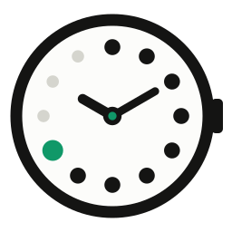
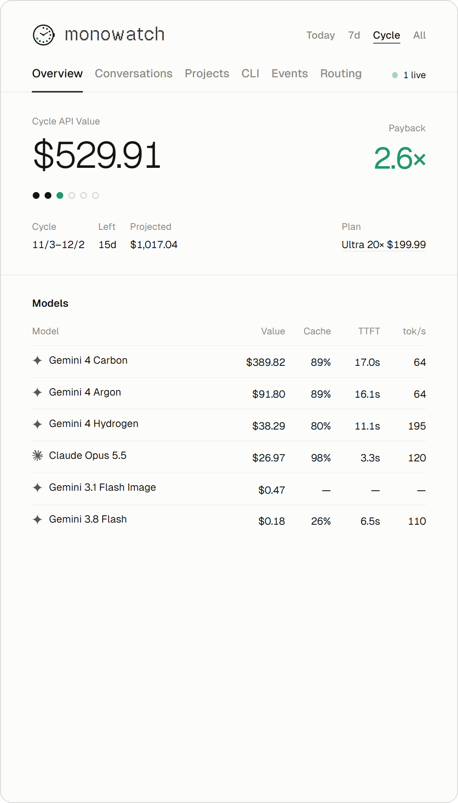
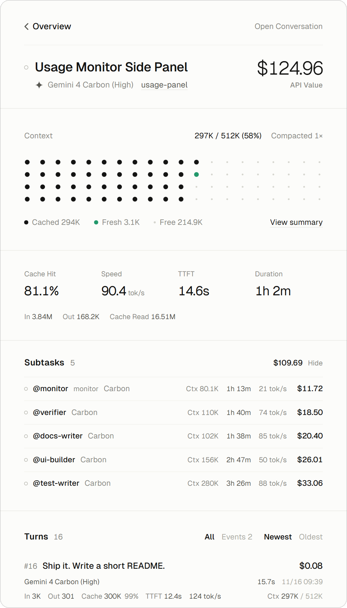
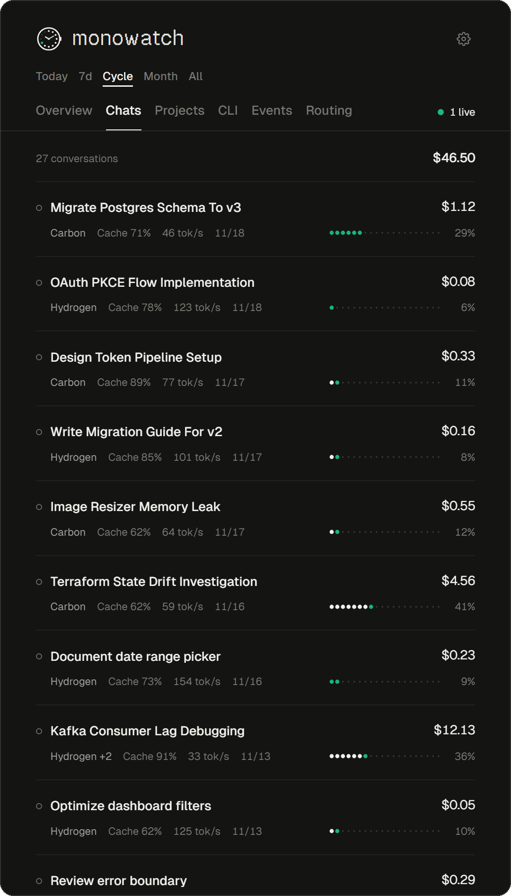

<div align="center">
  
  <h1>monowatch</h1>
  <p>A local usage dashboard for Google Antigravity, in the side panel.</p>
  <p><strong>English</strong> · <a href="./README.zh-CN.md">简体中文</a></p>
</div>

<p align="center">
  
  
  
</p>

## Features

- **Subscription value**: see what your usage would cost at API prices, and how many times over your plan has paid for itself in the current billing cycle.
- **Per-model performance**: cost, cache hit rate, time to first token and output speed for every model you use.
- **Conversations, projects and CLI runs**: each one shows its cost, context usage and speed, and you can sort them by workspace.
- **Conversation detail**: context window usage, compaction history, subagent costs and a per-turn breakdown.
- **Local and read-only**: reads Antigravity's local data and never writes to it. No data is uploaded.
- **Light / dark, English / Chinese**: follows the host theme and language automatically.

## Install

### Option 1: Let Antigravity install it (Agentic)

Send this prompt to Antigravity in a chat:

```text
Install https://github.com/riverxorange/agy-monowatch as a plugin, enable it, and open monowatch for me.
```

Once installed, you can mention `@[plugin:monowatch]` in any conversation (or ask Antigravity to open it) to bring up the dashboard.

### Option 2: Manual install

```bash
git clone https://github.com/riverxorange/agy-monowatch.git ~/.gemini/config/plugins/monowatch
```

On Windows (PowerShell):

```powershell
git clone https://github.com/riverxorange/agy-monowatch.git "$HOME\.gemini\config\plugins\monowatch"
```

Then enable **monowatch** on Antigravity's Customizations page and open it from the side panel.

## Update

When a new version is available, an **Update** link appears in the panel header. You can also run `git pull` in the plugin directory. Your settings are stored separately and survive updates.

## Privacy

monowatch makes one kind of network request: a version check against GitHub at most once an hour. You can turn it off in Settings.

## Development

Requires only Node.js built-ins (no npm dependencies).

```bash
npm --prefix sidecars/monitor_board test
```

How the data is read and calculated: [docs/TELEMETRY_SPEC.md](./docs/TELEMETRY_SPEC.md).

## License

[MIT](./LICENSE). Bundled Geist fonts are licensed under the [SIL Open Font License](./sidecars/monitor_board/fonts/OFL.txt).

Thanks to the [LINUX DO](https://linux.do) community. This is an unofficial community project and is not affiliated with Google.
