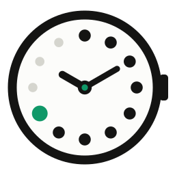
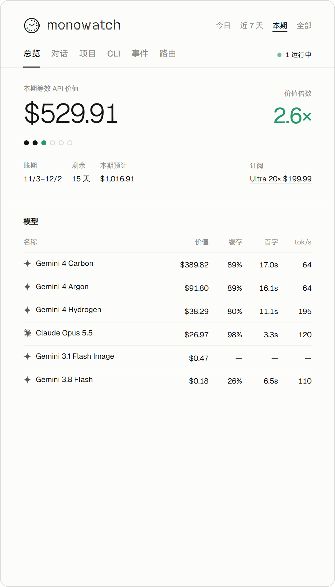
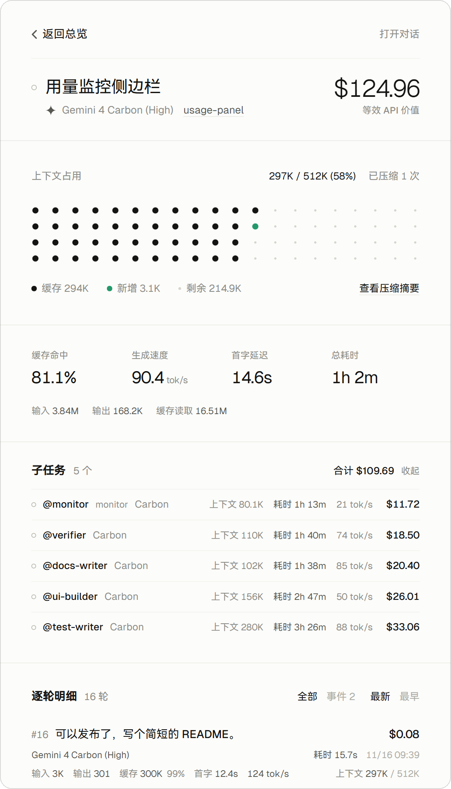
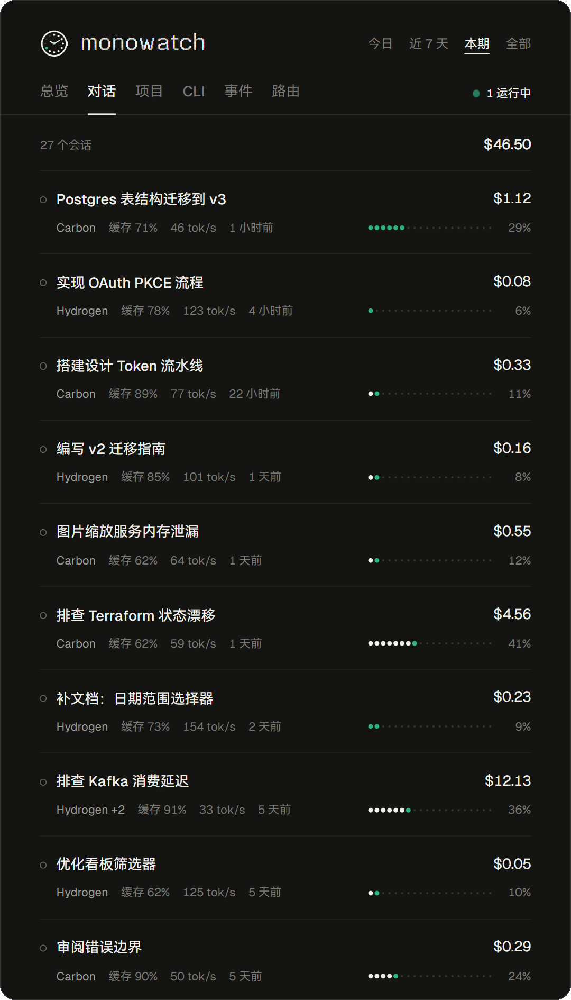

<div align="center">
  
  <h1>monowatch</h1>
  <p>放在 Google Antigravity 侧边栏里的本地用量看板。</p>
  <p><a href="./README.md">English</a> · <strong>简体中文</strong></p>
</div>

<p align="center">
  
  
  
</p>

## 功能

- **订阅价值**：按 API 价格折算你的用量，并显示本计费周期内订阅价值是月费的几倍。
- **模型表现**：每个模型的费用、缓存命中率、首字延迟和输出速度。
- **对话、项目与 CLI**：每条记录都显示费用、上下文占用和速度，可按工作区归类。
- **对话详情**：上下文窗口占用、压缩记录、子代理开销和逐轮明细。
- **本地只读**：只读取 Antigravity 的本地数据，不做任何写入，也不上传任何数据。
- **明暗主题、中英双语**：自动跟随宿主的主题和语言。

## 安装

```bash
git clone https://github.com/riverxorange/agy-monowatch.git ~/.gemini/config/plugins/monowatch
```

Windows（PowerShell）：

```powershell
git clone https://github.com/riverxorange/agy-monowatch.git "$HOME\.gemini\config\plugins\monowatch"
```

然后在 Antigravity 的插件管理页启用 **monowatch**，从侧边栏打开即可。

## 更新

有新版本时，面板顶栏会出现「更新」链接，点击即可。也可以在插件目录执行 `git pull`。设置单独存放，更新后不会丢失。

## 隐私

monowatch 只发出一种网络请求：向 GitHub 检查版本，最多每 6 小时一次，可在设置中关闭。

## 开发

只依赖 Node.js 内置模块，没有 npm 依赖。

```bash
npm --prefix sidecars/monitor_board test
```

数据读取与计算方式见 [docs/TELEMETRY_SPEC.md](./docs/TELEMETRY_SPEC.md)。

## 许可

[MIT](./LICENSE)。内置的 Geist 字体采用 [SIL Open Font License](./sidecars/monitor_board/fonts/OFL.txt)。

感谢 [LINUX DO](https://linux.do) 社区交流与支持。本项目为非官方社区项目，与 Google 无关。
